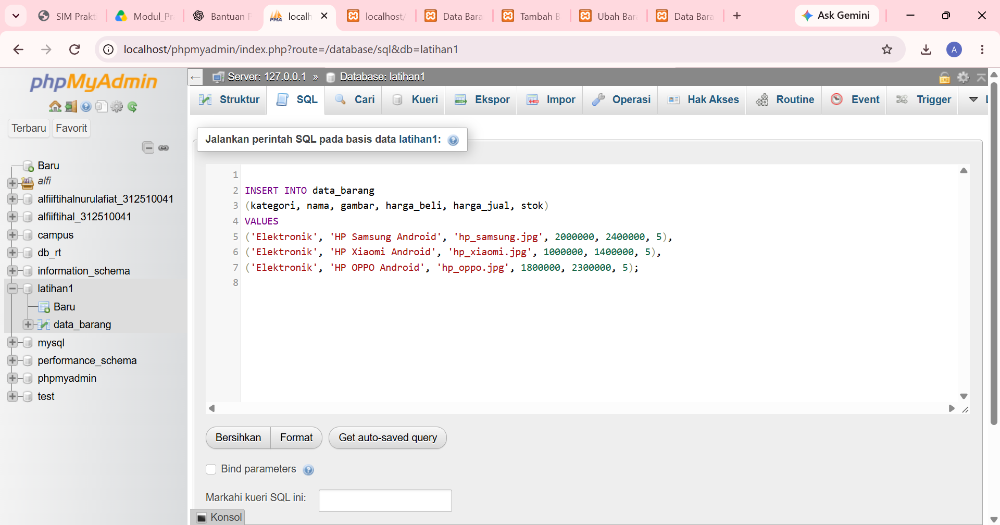

# PRAKTIKUM 8 – PHP DAN DATABASE MYSQL

## Identitas Mahasiswa
- **Nama:** Alfi Iftihal Nurul Afiat
- **NIM:** 312510041
- **Kelas:** I251D
- **Mata Kuliah:** Pemrograman Web 
- **Program Studi:** Teknik Informatika

---

## 1. Tujuan Praktikum

Praktikum ini bertujuan untuk:
1. Memahami konsep dasar database.
2. Memahami konsep dasar CRUD menggunakan PHP.
3. Membuat program CRUD sederhana menggunakan PHP.

## 2. Alat dan Bahan

1. XAMPP sebagai web server lokal.
2. Visual Studio Code sebagai text editor.
3. MySQL sebagai database.
4. phpMyAdmin untuk mengelola database.
5. Web browser untuk menjalankan aplikasi.
6. GitHub untuk menyimpan hasil praktikum.

## 3. Persiapan Praktikum

Menjalankan Apache dan MySQL melalui XAMPP Control Panel. Setelah kedua layanan aktif, phpMyAdmin dapat diakses melalui:

`http://localhost/phpmyadmin/`

## 4. Membuat Database

Membuat database dengan nama `latihan1` menggunakan perintah SQL:

```sql
CREATE DATABASE latihan1;
```

Database ini digunakan untuk menyimpan data barang yang akan dikelola melalui aplikasi PHP.


## 5. Membuat Tabel data_barang

Membuat tabel `data_barang` dengan struktur sebagai berikut:

```sql
CREATE TABLE data_barang (
    id_barang INT(10) AUTO_INCREMENT PRIMARY KEY,
    kategori VARCHAR(30),
    nama VARCHAR(30),
    gambar VARCHAR(100),
    harga_beli DECIMAL(10,0),
    harga_jual DECIMAL(10,0),
    stok INT(4)
);
```

Tabel terdiri dari tujuh kolom, yaitu id_barang, kategori, nama, gambar, harga_beli, harga_jual, dan stok.

**Dokumentasi:**


## 6. Menambahkan Data Barang

Memasukkan tiga data awal ke dalam tabel `data_barang` menggunakan perintah INSERT:

```sql
INSERT INTO data_barang
(kategori, nama, gambar, harga_beli, harga_jual, stok)
VALUES
('Elektronik', 'HP Samsung Android', 'hp_samsung.jpg', 2000000, 2400000, 5),
('Elektronik', 'HP Xiaomi Android', 'hp_xiaomi.jpg', 1000000, 1400000, 5),
('Elektronik', 'HP OPPO Android', 'hp_oppo.jpg', 1800000, 2300000, 5);
```

**Dokumentasi:**


## 7. Membuat Program CRUD

Folder proyek dibuat dengan nama `lab8_php_database` di dalam direktori `htdocs`.

### A. Koneksi Database (koneksi.php)

File `koneksi.php` digunakan untuk menghubungkan aplikasi PHP dengan database MySQL menggunakan fungsi `mysqli_connect()`.

Konfigurasi database:
- Host: localhost
- Username: root
- Password: kosong
- Database: latihan1

**Dokumentasi:**


### B. Menampilkan Data (Read)

File `index.php` digunakan untuk menampilkan seluruh data barang dari database menggunakan perintah SQL SELECT.

Data ditampilkan dalam bentuk tabel yang memuat gambar, nama barang, kategori, harga beli, harga jual, stok, dan aksi.

**Dokumentasi:**


### C. Menambah Data (Create)

File `tambah.php` digunakan untuk menambahkan data barang baru melalui formulir yang terdiri dari:
- Nama Barang
- Kategori
- Harga Jual
- Harga Beli
- Stok
- File Gambar

Data yang dimasukkan akan disimpan ke database menggunakan perintah INSERT.

**Dokumentasi:**


### D. Mengubah Data (Update)

File `ubah.php` digunakan untuk mengubah informasi barang yang sudah tersimpan di database.

Data barang diambil berdasarkan `id_barang`, kemudian ditampilkan dalam formulir untuk diedit dan disimpan kembali menggunakan perintah UPDATE.

**Dokumentasi:**


### E. Menghapus Data (Delete)

File `hapus.php` digunakan untuk menghapus data barang berdasarkan `id_barang` menggunakan perintah DELETE.

Setelah proses penghapusan berhasil, pengguna diarahkan kembali ke halaman utama.

**Dokumentasi:**


## 8. Membuat Tampilan dengan CSS

File `style.css` digunakan untuk memperbaiki tampilan aplikasi agar lebih rapi dan mudah digunakan.

Pengaturan CSS meliputi:
- Jenis dan ukuran font.
- Warna background.
- Tata letak kontainer.
- Tampilan tabel.
- Tampilan formulir.
- Desain tombol dan tautan.

**Dokumentasi:**


## 9. Hasil Praktikum

Hasil praktikum berupa aplikasi pengelolaan data barang berbasis PHP dan MySQL yang memiliki empat fungsi utama CRUD:

1. **Create:** Menambahkan data barang.
2. **Read:** Menampilkan data barang.
3. **Update:** Mengubah data barang.
4. **Delete:** Menghapus data barang.

Aplikasi dijalankan melalui browser menggunakan alamat:

`http://localhost/lab8_php_database/`

## 10. Kesimpulan

Berdasarkan praktikum yang telah dilakukan, PHP dapat digunakan untuk membangun aplikasi CRUD sederhana yang terhubung dengan database MySQL. Melalui praktikum ini, proses menampilkan, menambahkan, mengubah, dan menghapus data barang dapat dilakukan melalui aplikasi web. Penggunaan CSS juga membantu menghasilkan tampilan aplikasi yang lebih terstruktur dan mudah digunakan.


**Program Studi Teknik Informatika**  
**Praktikum Pemrograman Web OBE**
